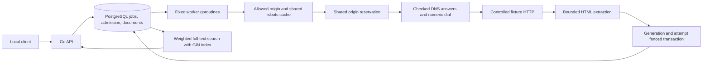

# Reviewer walkthrough

This walkthrough runs the existing crawler against controlled local fixtures and emits a transcript from actual API responses and assertions. It uses two independent disposable stacks: a 24-page corpus for submission/extraction/search, then a mutable one-URL fixture for refresh/failure/recovery. Both stacks may have job 1; those are different databases and URLs.

## Run one command

From a Git checkout with Python 3, Git and Docker Compose using Linux containers:

```sh
python scripts/reviewer_demo.py --output .work/reviewer-first
```

Use a fresh output directory each time; the command refuses to overwrite an existing result. It builds/runs the repository image, binds only random loopback API/fixture ports and removes its uniquely named stacks and volumes. It never resets the ordinary `crawlindex_data` volume. First runs may need image downloads. Python uses only its standard library; host Go/PostgreSQL are not required. This is a local command-line demonstration, not a hosted UI.

Open `.work/reviewer-first/transcript.txt` for the readable result and `report.json` for source status, captured examples and checksums. Under `corpus/` are the single-run report, raw SQL/resource/document observations and command log; under `refresh/` are the generation/failure report and command log. Console logs preserve each child command's output. A failed child makes the overall command fail while retaining its output; neither stage fabricates a successful transcript. Existing fixture/harness bounds and owned cleanup apply.

The [recorded local transcript](demo-local/transcript.txt) and [report](demo-local/report.json) provide a no-Docker preview. These derive from a real dirty precommit run based on `131f1f0`; the report identifies that boundary. Its phase captions were clarified to distinguish the two databases; API values and child reports were preserved. The original output remains separately retained. CI runs the same command from clean committed source and retains a `reviewer-demo` artifact with the transcript, report and underlying evidence; use the exact revision's [workflow run](https://github.com/owanden/crawlindex/actions/workflows/ci.yaml) for current results.

## Follow the evidence

| Stage | What to inspect | What it establishes |
|---|---|---|
| Submit corpus | Root POST, document title/body excerpt/hash, unique-token match | One root discovers 23 leaves; all 24 expected texts and unique searches pass, script marker is absent, common query respects the 20-result cap |
| Refresh separate fixture | `Oldword` generation 1 becomes `Freshword` generation 2 | Same URL/ID/slot; 16 concurrent generation-1 requests coalesce, and old search text disappears only after successful replacement |
| Persist state | Queue before workers resume; terminal failure after restart | Queued generation 2 and its previous document survive database/API restart; later generation-3 failure and last-good generation-2 text also persist |
| Bound failure | Three real HTTP 503 attempts | Job becomes failed while the prior successful document stays searchable; document generation can lag job generation |
| Respect policy | Generation 4 robots denial and unchanged page counter | No additional page fetch after the denied policy decision; existing indexed content is retained |
| Explicit recovery | Generation 5 done at attempt 1 | An explicit later refresh can recover; one retained slot remains occupied at the one-URL cap throughout this stage |

The single corpus pass is presentation, not the three-run experiment. Its observed endpoint includes policy and polling overhead. [Repeated measurements](workload.md) retain the actual 24-page/393,216-byte observations and uncertainty; the one-origin claim-plus-page reservations imply approximately one page/second, not maximum capacity or scaling speedup.

## Architecture in one trace



PostgreSQL coordinates admission, origin reservations and leases instead of an unbounded in-memory queue. Both initial submission and discovered URLs share the retained-URL cap; a refresh reuses its URL slot. A claim carries generation plus attempt, and success/retry/robots-denial writes require both plus a valid lease. The actual database tests cover the stale attempt-one/generation collision; the walkthrough does not forge a stale write. Successful document, search-vector and discovered-link changes commit with job completion. Failed refreshes preserve the last successful document, labeled by its producing generation.

Follow that trace in the [API](../internal/crawler/api.go), [store/claim/finish](../internal/crawler/store.go), [worker loop](../internal/crawler/worker.go), [robots cache](../internal/crawler/robots.go) and [checked dialer](../internal/crawler/egress.go). The [recrawl tests](../internal/crawler/recrawl_test.go) exercise stale-generation writes and active-work conflicts against actual PostgreSQL. Transcript excerpts and computed hashes are labeled summaries; they are not extra fields in the HTTP API's full-document schema.

Robots decisions use a persisted origin cache with fixed TTLs. Page and policy requests share the no-proxy/no-redirect client and connection-time destination checks. The demo's exact `http://fixture:8081` private-network exception is deliberate controlled-test configuration; it is not arbitrary LAN access. These policies and the extra claim reservation favor bounded, inspectable behavior over measured maximum throughput.

## What this restart does—and the separate crash evidence

The walkthrough restarts the database/API and resumes stopped workers; it does not kill an active worker. Actual hard-process recovery and Kubernetes container exit 137/pod replacement were separately executed. See the [verification history](verification.md), [Kubernetes report](kubernetes-ci-report.json), [cluster harness](../scripts/kubernetes_smoke.py), and the independently inspected [full workload/policy/recovery CI run](https://github.com/owanden/crawlindex/actions/runs/40509332535) for source-specific evidence. Remote HTTP can repeat after a crash; fenced database commits are not exactly-once network delivery.

Keep [recrawl semantics](recrawl.md), [robots choices](architecture.md#robots-decisions), [admission](architecture.md#durable-admission) and [egress limits](egress.md) in view while reading the output. Retaining old indexed content after failure/robots denial is explicit behavior, not a fresh-policy success. The cap counts retained URLs, not disk bytes or lifetime requests. There is no authentication, scheduler, production operations or GCP deployment; public-web targets remain out of scope.
